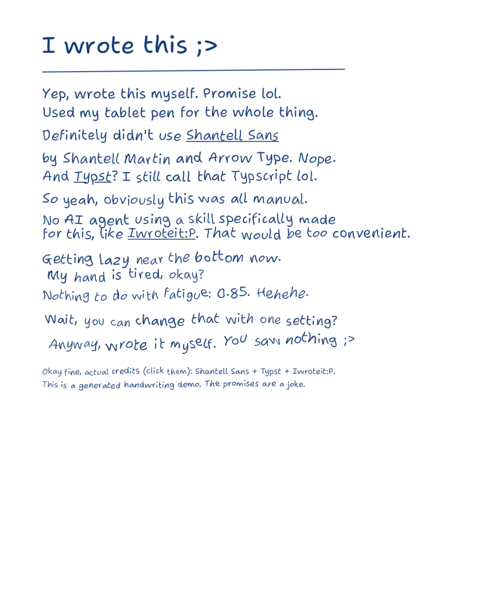

# Iwroteit:P

A Codex skill for making digital handwritten-style PDFs with Typst. It combines
actual alternate glyphs with variable letter shapes, baseline bounce, spacing,
and slope. Keep editable Typst source; export image-only PDFs by default, or
choose selectable text explicitly.



[Open the demo PDF with clickable credits](assets/demo.pdf)

## How the variation works

This is more than selecting a handwriting font. The bundled Shantell Sans font
cycles real alternate glyphs, and a seeded Typst helper varies font axes between
words while preserving contextual shaping inside each word. Settings are
reproducible, so a rebuild does not randomly change the document.

The tested specimen uses four glyphs for repeated `a`, four for repeated `C`,
and three for repeated `1` when cycling is enabled, compared with one each
when cycling is disabled. Variable-axis interpolation adds many further
rendered variations. This does **not** mean 50 independently drawn versions of
every letter, and the font is not a copy of any user's personal handwriting.

## Use as a Codex skill

Place this folder at `.agents/skills/iwroteit/` inside your workspace, or at
`~/.codex/skills/iwroteit/` for a personal installation. Ask Codex:

> Use $iwroteit to create a digital handwritten PDF with blue ink, highlighted
> answers, and natural letterform variation.

The display name is **Iwroteit:P**; the technical skill name is `iwroteit`.

## Run directly

Requirements: Typst CLI with custom variable-font axis support (tested with
0.15.1), Python 3, and PyMuPDF for image-only export and PDF verification.
The font is bundled and requires no system font installation.

From the repository root:

```sh
python scripts/compile.py assets/specimen.typ specimen.pdf --root . --selectable
python scripts/verify_variation.py specimen.pdf
```

Import `assets/handwriting.typ` into a `.typ` document, using a path relative to
that document. The Typst project root must contain the imported template.

```typst
#import "assets/handwriting.typ": *
#show: handwritten.with(size: 12pt, paper: "plain")
#hw("Notes written digitally", intensity: 65%, seed: 11)
#topic(1, "Probability")
#note("Three favorable outcomes out of six.", seed: 21)
#work("P(A) = 3/6 = 1/2", seed: 31)
#answer("Answer: 1/2 = 50%", seed: 41)
```

## One main naturalness setting

Set **`intensity: 0%` to `100%`**. The default is `60%`. This is a Typst
parameter, not a graphical slider. It coordinates letter-shape irregularity,
baseline bounce/wander, word spacing, letter scale, slant, and stroke-weight
variation. `0%` removes the helper's added irregularity; the font's real
alternate-glyph cycling remains on.

Set it **once for the whole document**, then override individual passages only
if needed:

```typst
#show: handwritten.with(intensity: 75%)
#hw("This inherits the document's 75% intensity.")
#hw("This passage is deliberately neater.", intensity: 10%)
```

```typst
#hw("Neat and consistent.", intensity: 15%)
#hw("Normal tablet notes.", intensity: 60%)
#hw("Looser, less perfect writing.", intensity: 95%)
```

Optional overrides take precedence over the corresponding master defaults:

```typst
#hw("Loose writing with steady size and heavy ink.",
  intensity: 85%, scale-jitter: 0%, stroke-weight: 460, pressure: 0)
```

## Make later writing progressively looser

`fatigue` is a visual preset, not a claim about the writer's physical state.
Set it per paragraph, or use `fatigue-to` to ramp across a text run. It adds
irregularity, a little size reduction, more baseline movement, and variable
stroke weight. The effect is opt-in and combines with the master setting.

```typst
#hw("Start neat and gradually lose patience with this sentence.",
  intensity: 70%, fatigue: 0, fatigue-to: 0.9)
#handline("This line has stopped respecting the ruler.",
  intensity: 90%, fatigue: 0.8, angle: -0.6deg,
  baseline-drift: -2pt, baseline-wave: 1pt, gap: 12pt)
```

| Override | What it changes |
|---|---|
| `word-space`, `space-jitter` | Average gap and gap variation; e.g. `110%`, `30%` |
| `scale`, `scale-jitter` | Letter size and size variation; e.g. `98%`, `8%` |
| `tracking` | Extra letter spacing, e.g. `0.1pt` |
| `irregularity`, `bounce`, `variation` | Shape axis, glyph bounce, added variation strength |
| `slant`, `slant-jitter` | Font italic axis and its variation, in 0-1 units |
| `baseline-drift`, `baseline-wave` | End-to-end drift and smooth baseline wave |
| `stroke-weight`, `pressure` | Font weight 300-800 and per-word weight variation |
| `fatigue`, `fatigue-to` | Fixed or progressive looseness, from 0 to 1 |
| `handline`: `angle`, `inset`, `gap` | Whole-line slope, left indent, and line spacing |

Stroke controls interpolate font-outline weight. They do not reconstruct
individual pen trajectories or pressure changes inside a single stroke. Long
auto-wrapped paragraphs keep their word progression across wraps; use explicit
`handline` calls when each physical line needs its own slope or baseline reset.

Customize ink and plain/ruled paper with `handwritten`. `hfrac` and `hpower` provide handwritten fractions and
superscripts without a printed math-font fallback. Complex mathematical
notation requires additional layout and glyph review; this is not a complete
OpenType math font.

For black ink and brush-style answer highlights:

```typst
#show: handwritten.with(ink: black, intensity: 90%)
#brush-answer("P(A) = 1/2 = 50%", seed: 7)
```

`brush-highlight` also wraps short custom content. Its vector swipes have
uneven edges, slanted ends and overlapping translucent layers. Keep each swipe
within one line; split longer answers into separate highlighted lines.

[Technical glyph-cycling specimen](assets/specimen.pdf) remains separate from
the humorous public demo. Run its verification with the commands above.

For master-control regression checks:

```sh
python scripts/compile.py scripts/fixtures/controls.typ test-output/controls.pdf --root . --selectable
python scripts/verify_controls.py test-output/controls.pdf
```

This checks actual exported scale/baseline geometry, document inheritance,
passage overrides, and individual-property precedence. The demo and technical
specimen were also rendered and visually reviewed.

## Selection and copy/paste: off by default

```sh
# Default: 300-DPI page images, no embedded selectable text
python scripts/compile.py assets/demo.typ demo.pdf --root .
# Explicit off (same as the default)
python scripts/compile.py assets/demo.typ demo.pdf --root . --no-selectable
# On: retain Typst's vector text for selection, searching and copying
python scripts/compile.py assets/demo.typ demo.pdf --root . --selectable
```

Image-only export contains no hidden text layer and preserves clickable URI
credits. `--dpi 400` changes raster resolution. Separate OCR software may still
recognize the images: this switch controls the PDF's own text layer, not whether
another program is allowed to perform OCR. Image-only output also loses text
search and text-based accessibility. Keep the `.typ` source for editing.
Use `--selectable` for glyph/geometry tests, which need actual text objects.

Verify the exported mode with `python scripts/verify_export.py demo.pdf`, or
append `--selectable` when checking an intentionally selectable document.

## Consistent handwriting throughout

Apply the same handwritten treatment to titles, section labels, tables,
captions, page numbers, inline code, superscripts, and equations. The template
uses the handwriting font for raw/code elements too. Use `hw` for controlled
variation in visible text, `hfrac`/`hpower` for simple notation, and brush swipes
for hand-marked highlights. Check for printed-font fallbacks before flattening;
rasterization alone cannot make a printed equation look handwritten.

## Licenses and sources

Skill, helper scripts, and Typst template: MIT. Bundled font: SIL OFL 1.1, with
the full license preserved in `assets/fonts/OFL.txt`.

- [Shantell Sans font project](https://github.com/arrowtype/shantell-sans)
- [Font design process](https://shantellsans.com/process)
- [Typst text and font controls](https://typst.app/docs/reference/text/text/)
- [Research notes and alternative engines](references/research.md)

The repository contains a generic specimen; it contains no personal coursework.
