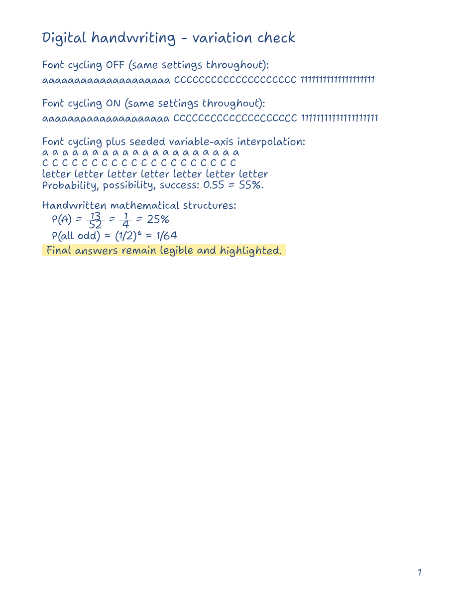

# Iwroteit:P

A Codex skill for making digital handwritten-style PDFs with Typst. It combines
actual alternate glyphs with variable letter shapes, baseline bounce, spacing,
and slope. The result stays editable, vector-based, and searchable.



[Open the sample PDF](assets/specimen.pdf)

## How the variation works

This is more than selecting a handwriting font. The bundled Shantell Sans font
cycles real alternate glyphs, and a seeded Typst helper varies font axes between
words while preserving contextual shaping inside each word. Settings are
reproducible, so a rebuild does not randomly change the document.

The tested specimen uses four glyphs for repeated `a`, four for repeated `C`,
and three for repeated `1` when cycling is enabled, compared with one each
when cycling is disabled. Variable-axis interpolation adds many further
rendered variations. This does **not** mean 50 independently drawn versions of
every letter, and the font is not a copy of any user's personal handwriting.

## Use as a Codex skill

Place this folder at `.agents/skills/iwroteit/` inside your workspace, or at
`~/.codex/skills/iwroteit/` for a personal installation. Ask Codex:

> Use $iwroteit to create a digital handwritten PDF with blue ink, highlighted
> answers, and natural letterform variation.

The display name is **Iwroteit:P**; the technical skill name is `iwroteit`.

## Run directly

Requirements: Typst CLI with custom variable-font axis support (tested with
0.15.1), Python 3, and PyMuPDF for the optional PDF verification script.
The font is bundled and requires no system font installation.

From the repository root:

```sh
python scripts/compile.py assets/specimen.typ specimen.pdf --root .
python scripts/verify_variation.py specimen.pdf
```

Import `assets/handwriting.typ` into a `.typ` document, using a path relative to
that document. The Typst project root must contain the imported template.

```typst
#import "assets/handwriting.typ": *
#show: handwritten.with(size: 12pt, paper: "plain")
#hw("Notes written digitally", seed: 11)
#topic(1, "Probability")
#note("Three favorable outcomes out of six.", seed: 21)
#work("P(A) = 3/6 = 1/2", seed: 31)
#answer("Answer: 1/2 = 50%", seed: 41)
```

Customize ink, font size, plain/ruled paper, seeds, irregularity, bounce, and
variation strength. `hfrac` and `hpower` provide handwritten fractions and
superscripts without a printed math-font fallback. Complex mathematical
notation requires additional layout and glyph review; this is not a complete
OpenType math font.

## Licenses and sources

Skill, helper scripts, and Typst template: MIT. Bundled font: SIL OFL 1.1, with
the full license preserved in `assets/fonts/OFL.txt`.

- [Shantell Sans font project](https://github.com/arrowtype/shantell-sans)
- [Font design process](https://shantellsans.com/process)
- [Typst text and font controls](https://typst.app/docs/reference/text/text/)
- [Research notes and alternative engines](references/research.md)

The repository contains a generic specimen; it contains no personal coursework.
